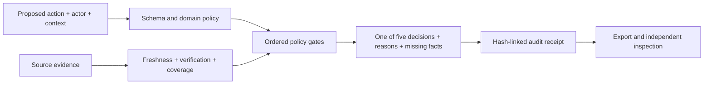

# Decision Gate

A small, deterministic decision layer for the [DOO Builders League Decision Engine challenge](https://build.doo.ooo/challenges/decision-engine). An agent can propose a refund, release, or content action. This gate returns **execute**, **ask**, **defer**, **escalate**, or **refuse** from explicit authority, evidence, freshness, confidence, risk, and review rules. It does not execute the proposed action.

## Run

Open the [live demo](https://samerzaher80.github.io/decision-gate-demo/) or run locally:

```bash
python -m http.server 8080
```

Then visit `http://localhost:8080`. No API keys, accounts, build step, or real records are needed. Run tests with `npm test` (Node 20+).

## Three example domains

| Domain | Proposed action | Required evidence | Deliberate boundary |
| --- | --- | --- | --- |
| Refund | Approve a $75 duplicate-payment refund | Order, payment, refund policy | Actor needs `refund:approve`; over $100 goes to human review; over $500 is refused. |
| Deploy | Ship a software release | Build, tests, change approval | A successful pipeline alone cannot replace a named human approval. |
| Moderation | Remove a reported post | Content, policy match, review trace | Missing review trace produces **ask**. |

Use the signal selector to make a source stale, remove evidence, revoke authority, or mark an action prohibited. A stale source produces **defer**; revoked authority produces **refuse**. Each run records the complete proposal and result in a SHA-256 linked audit chain. Export JSON and call `verifyAudit` in the code to check for post-export edits.

## Architecture



The ordered gates matter: policy prohibition and absent authority fail closed; stale evidence defers; missing evidence asks; risk or missing human review escalates; only the remaining case can execute. Confidence is an evidence-quality indicator based on required-source coverage and declared source confidence. It is **not** a calibrated probability of correctness. Risk scores are transparent policy heuristics, not validated loss estimates. Hash links detect edits within a chain; they do not authenticate the original source, time, or operator.

## Deliberate failure test

1. Select **Refund approval** and evaluate the baseline: `execute`.
2. Select **Make one source stale** and evaluate again: `defer`, with `EVIDENCE_STALE` and the stale source named.
3. Select **Revoke actor authority** and evaluate: `refuse`, even with otherwise complete evidence.
4. Export the audit. Change one decision in the JSON, then pass its entries to `verifyAudit`: integrity fails. The automated tests check this tampering case.

All case data are synthetic. The demo has no action connectors and makes no production or safety certification claim.

## Two-year thesis (under 300 words)

Decision layers will become the boundary between models that can suggest actions and systems that can commit them. The decisive architecture is not a single risk score. It is an explicit, inspectable contract among authority, current evidence, reversibility, and the human who owns an exception. Agents should carry proposals and provenance to that boundary, then receive a narrow decision and the exact missing work needed to proceed. Tools should reject proposals without a valid decision receipt. Over time, deployments will need to bind that receipt to the specific model output, policy version, data sources, and observed outcome. The hard research problem is validating those sources and measuring when a gate is too permissive or too costly; a hash alone proves neither. Systems that can show why they waited, escalated, or refused will earn more trust than systems that merely act faster.

## Scope and provenance

Built as a fresh, public challenge demonstration by Sameer S. Najm / Sam AI Lab. It illustrates design principles also explored in private research; no private repositories, clinical data, customer data, or proprietary model weights are included.
